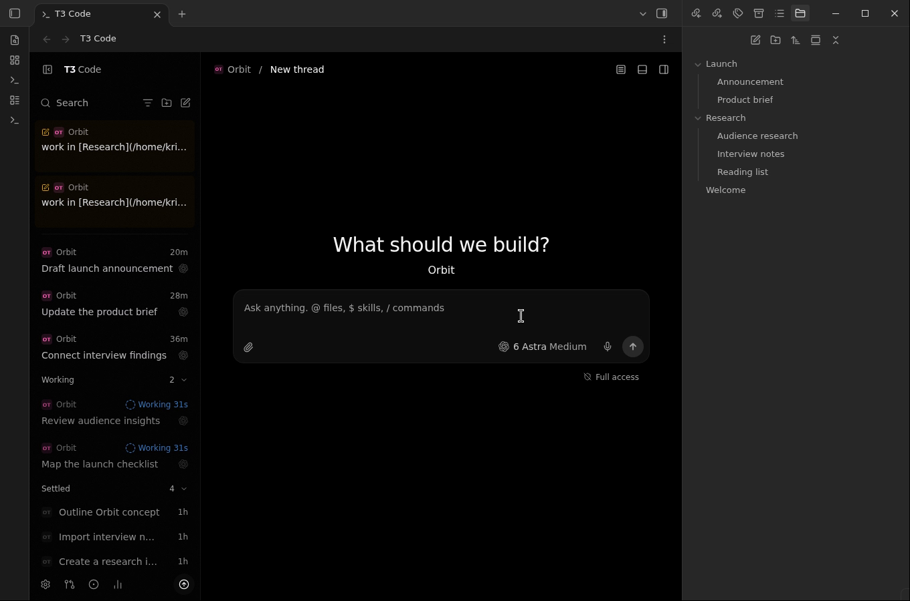
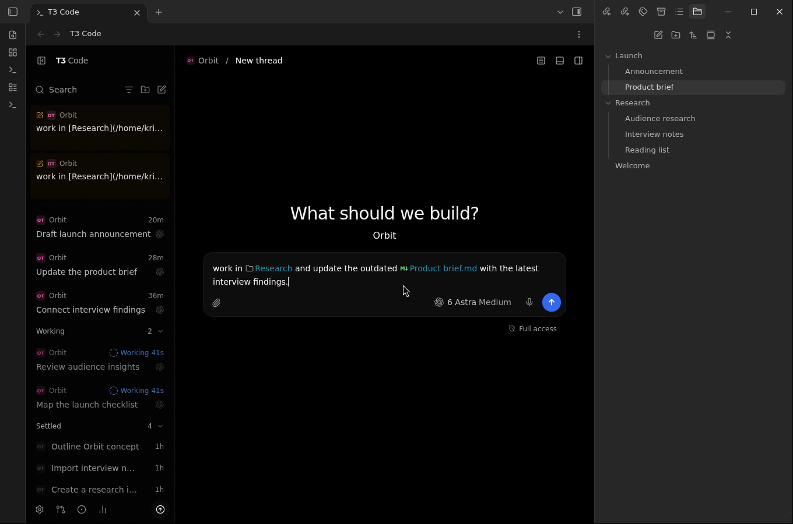
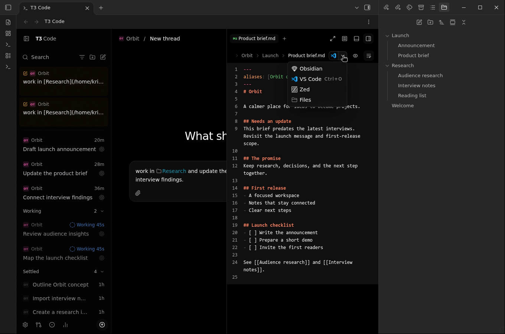
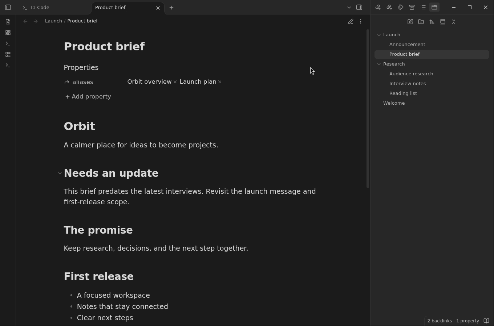
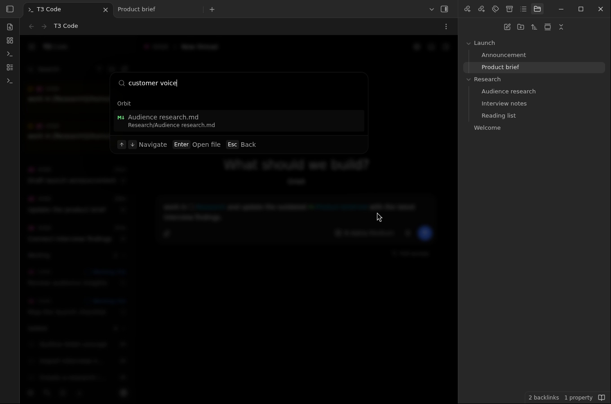

# threecode

threecode brings your T3 Code workspace into Obsidian. Work with agents alongside your notes, add vault context to a prompt, and open Markdown files in Obsidian's editor.

[Watch the demo on YouTube](https://youtu.be/K0_4F2DAwRs)

## Features

| Demo | Description |
| --- | --- |
|  | **Add notes and folders to your prompt.** Drag notes and folders from Obsidian's file explorer into the T3 composer. Use **Add selection to T3** or **Add current note to T3** to include note text, including unsaved edits. Review the draft before sending. Notes are not sent automatically. |
|  | **Open files in Obsidian.** Use **Open in Obsidian** from T3's file actions, or Ctrl/Cmd-click a Markdown file. Plain clicks keep T3's preview. |
|  | **Keep editing in Obsidian.** Work with the original note using Obsidian's properties, internal links, and reading view. |
|  | **Find notes by alias.** Search by filename or an alias from the note's Obsidian properties. Alias matches point to the original note. |

### Follow Obsidian colors

Enable **Follow Obsidian theme** in the plugin settings to use your resolved Obsidian colors and light or dark appearance in T3. Theme customizations also apply. Choosing another T3 theme or appearance disables following. Selecting the generated **Obsidian** theme in T3, or enabling the plugin toggle, resumes following. Disabling it keeps the last generated palette. **Follow Obsidian fonts** is independent. It maps the interface font to T3 controls, the text font to chat and composer, and the monospace font to code and terminal. Font sizes stay in T3.

### Keep sessions focused on your vault

The embedded workspace shows sessions whose working directories belong to the current vault. Use **Use vault folder** to create a T3 project for your vault, or right-click a folder and select **Open folder in T3 Code**.

Press Escape when no T3 interaction needs it to return keyboard focus to Obsidian. Ctrl/Cmd+P then opens Obsidian's command palette. Click the composer to return to T3. Menus, dialogs, suggestions, and terminals keep their Escape behavior.

Vault filtering only changes which sessions appear in this view. It does not restrict an agent's filesystem access or change other T3 clients.

### Edit a composer draft in Obsidian

Select **Edit composer draft in Obsidian** from the T3 tab's header action or the command palette.
The draft opens in a temporary note beside that T3 tab, including in a sidebar.
Use Obsidian's normal editor, wikilink completion, and editor commands.
Draft files use the `.t3draft` extension and open in Obsidian's Markdown editor.
Keep threecode enabled to reopen these files.

Use **Return draft to T3 Code** in the temporary note's header or **More options** menu to update the originating composer.
The header action uses a return-arrow icon. The same command is available in the command palette.
Returning a draft does not send it. Automatic saves do not return it.
Existing attachments stay in the composer. By default, Return preserves the draft text exactly.

Enable **Format draft links on return** in the plugin settings to convert wikilinks into T3 file mentions.
Formatting uses full filenames, including extensions, as link labels so T3 can highlight them.
Existing Markdown file paths and encoded spaces stay unchanged. Generated wikilink paths are relative to the originating T3 project.
When formatting is enabled, missing or ambiguous wikilinks must be corrected before return. Block references cannot be formatted.

Use **Cancel draft editing** from the note header or menu to keep the composer unchanged and delete the temporary note.
Interrupted requests also keep their notes. Successful returns remove the temporary note.
If the composer changes during editing, return reports a conflict and preserves the note.
Return or copy active drafts before reloading or disabling threecode. Editing requests are held in memory.
After an interruption, copy a preserved note's text into a new composer.
Draft editing requires an active local composer inside the vault. Pending answers and queued-message edits are unavailable.

## Requirements

- Desktop Obsidian 1.14.5 or later.
- An existing local Windows, macOS, or Linux T3 server using orchestration protocol 2, running on the same computer and operating system as Obsidian.
- Internet access to download the plugin's required components during setup.

The embedded client targets T3 0.1.11. Local vault verification was tested on Windows with Obsidian 1.14.5, on Linux with Obsidian 1.15.1, and in a macOS 26.5.2 Intel VM with Obsidian 1.15.1. Windows Obsidian with a T3 server in WSL is not supported; run T3 natively on Windows so both applications use the same paths. See the [macOS verification](docs/verification/macos-0.1.1.md) for tested behavior and limits. Future incompatible T3 API changes may require a plugin update.

## Installation

### Install the plugin manually

1. Download `main.js`, `manifest.json`, and `styles.css` from the [latest release](https://github.com/kriss-spy/obsidian-t3code/releases/latest).
2. Create the folder `<vault>/.obsidian/plugins/threecode/`.
3. Copy the three files into that folder.
4. Reload Obsidian.
5. Enable **threecode** under **Settings → Community plugins**.

### Connect to T3

1. Open **Settings → threecode**.
2. Select **Download necessary files**.
3. Enter your existing T3 server address.
4. Select **Connect** to open the T3 workspace and check the connection. The result appears in a notice and under **Compatibility**.
5. Complete T3's pairing flow in the workspace. You can also open it later with **Open T3 Code** from the command palette or its ribbon icon.

If your vault has no T3 project, select **Use vault folder** to get started.

The plugin connects to the T3 server you already run. It does not install, patch, start, or stop the server. Configure your agents in T3.

## Commands

| Command | Action |
| --- | --- |
| **Open T3 Code** | Open the embedded T3 workspace. Also available from the ribbon. |
| **Focus T3 Code** | Open the workspace and collapse Obsidian's left sidebar. |
| **Add selection to T3** | Add selected editor text to the current draft. |
| **Add current note to T3** | Add the current note's text, including unsaved edits, to the current draft. |
| **Edit composer draft in Obsidian** | Open the current T3 composer's text in a temporary note. |
| **Return draft to T3 Code** | Return the temporary note's text without sending the prompt. |
| **Cancel composer draft editing** | End editing and delete the temporary note. |

You can assign hotkeys to these commands in **Settings → Hotkeys**.

## Downloaded components

**Download necessary files** installs the embedded T3 interface inside the plugin's folder. Downloads come from this repository's GitHub releases, with checksums pinned in the plugin. Once installed, these components work with your local server without another download.

**Download extra fonts** optionally installs Inter and terminal symbol fonts. System fonts are used by default. Fonts needed for mathematical notation are included in the required download.

If the plugin reports missing or changed components, download the necessary files again to repair them.

When a component is installed, its settings button becomes **Delete**.
Deleting extra fonts restores system fonts. Deleting necessary files makes the workspace unavailable until you download them again.

Version 0.2.0 requires a fresh component download after upgrading from 0.1.2.
Preserve `data.json` when replacing plugin files. See the [release notes](docs/release-notes.md) for upgrade steps and verification limits.

PDF, code, and Markdown previews are available. Office document previews and bundled device models are excluded. You can still save those files and open them in another application.

## Development

Install dependencies with `npm ci`, run tests with `npm test`, and build with `npm run build`.

The embedded client uses a pinned upstream revision and the client-only patch under `upstream/`. See the [development installation guide](docs/development-install.md) for setup details.

## License

[MIT](LICENSE). T3 Code and bundled components retain their respective licenses and notices.
